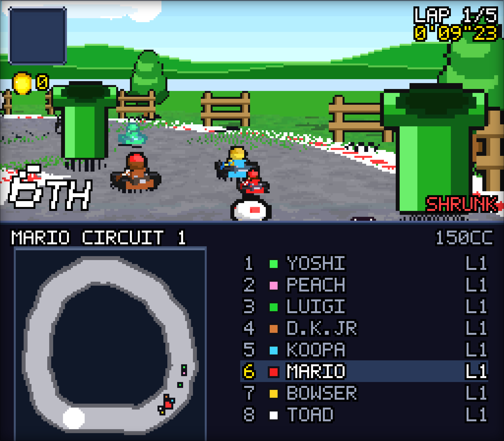
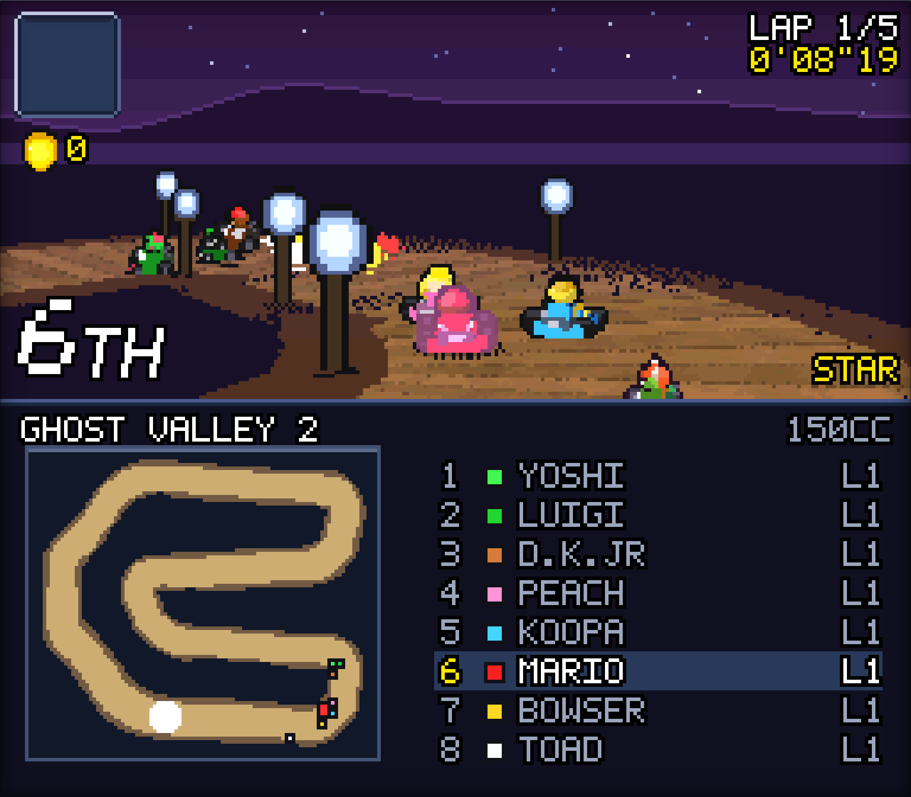
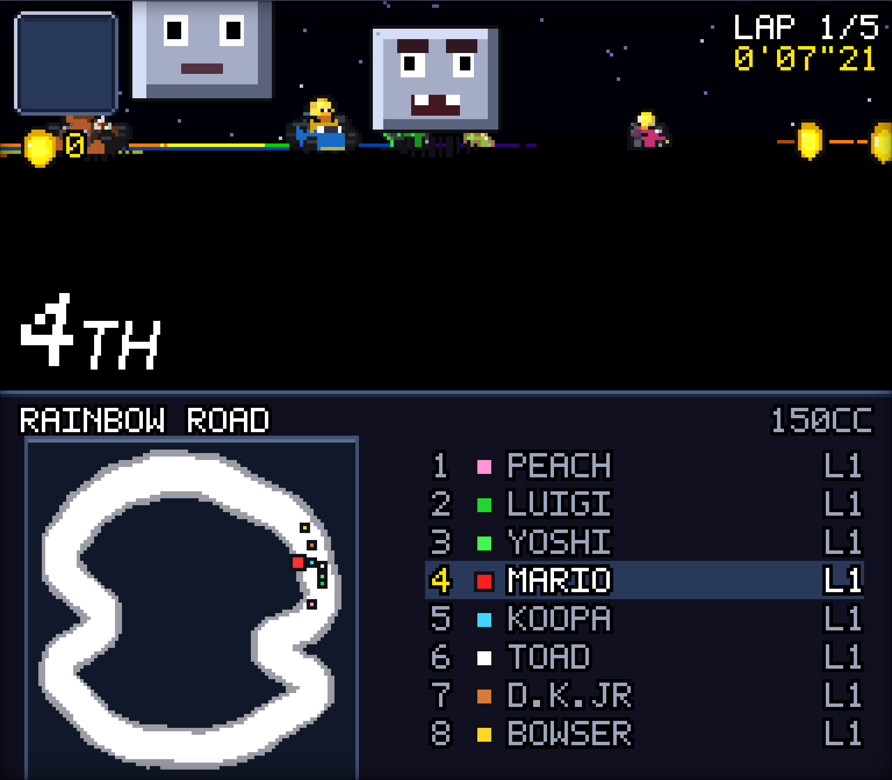

# Super Kart Grand Prix

A from-scratch, fully playable Mode 7 kart racer that runs in a browser.
No engine, no build step, no dependencies, and no image files — every
pixel is generated in JavaScript at boot.

Open `index.html` and drive.



<p align="center">
  
  
</p>

## Running it

```
open index.html
```

That's it — it works straight off disk. If your browser blocks local
files, any static server will do:

```
npx http-server . && open http://localhost:8080
```

## Controls

|  |  |
|---|---|
| **← →** | steer |
| **Z** | accelerate |
| **X** | brake / reverse |
| **C** | hop — hold it through a corner to power-slide |
| **Shift** | use item |
| **Enter** | start / confirm / pause |
| **Esc** | back / quit |
| **F** | fullscreen |
| **H** | HD Mode 7 (2x supersampled ground) |
| **V** | wide view (full-screen road, corner map) |
| **M** | mute |

A gamepad is picked up automatically. On a phone or tablet, on-screen
controls appear by themselves.

## What's in it

- **Grand Prix** — four cups of five courses, 50/100/150cc, points to
  the top four, championship standings and a trophy ceremony.
- **Time Trial** — alone against the clock, with three mushrooms and
  saved records per course and engine class.
- **VS Race** — one race on any of the twenty courses.
- **Battle** — four arenas, four karts, three balloons each, last one
  carrying balloons wins.
- **Twenty courses** across eight worlds: Mario Circuit, Donut Plains,
  Ghost Valley, Bowser Castle, Koopa Beach, Choco Island, Vanilla Lake
  and Rainbow Road — each with its own surfaces, hazards, horizon,
  roadside scenery and music.
- **Eight drivers** in three weight classes, each with the CPU-only
  special item their character carried in the original.
- **Full item set** — mushroom, triple mushroom, star, banana, green and
  red shells, feather, lightning, Boo and coins, drawn from a table
  weighted by your position.

## How it works

Everything composites into one 256x224 `Uint32Array` and reaches the
canvas through a single `putImageData` per frame. Nothing goes through
`drawImage`, so no GPU filtering can soften a pixel that a 16-bit
console would have shown hard.

The ground is a real per-scanline Mode 7 plane: walk down the screen,
work out how far ahead each row lands, and step across it sampling a
1024x1024 track texture. Karts are modelled as tapered boxes projected
through a fixed 23-degree camera and flat-shaded into three tones;
driver heads are shaded ellipsoids whose features are regions in
head-local space, so the back of a head shows hair rather than face at
every one of the sixteen headings. Courses are authored as rings of
corners joined by straights and baked into Mode 7 textures, surface maps
and racing lines.

Every colour passes through a 5-bit-per-channel quantiser — the same
lattice the SNES had — which is most of why the result reads as a 16-bit
console game rather than as modern art with a pixel filter over it.

`docs/DESIGN.md` covers the architecture, what is faithful to the 16-bit
original, and every place this deliberately departs from it.

## About the art

The game loads no image files at all. Sprites, tracks, horizons, fonts,
HUD and title art are all generated by the code in `js/art_*.js`,
`js/themes.js` and `js/trackgen.js` when the page opens. The only PNGs
in the repository are the screenshots in `docs/`.

The look is an original recreation in the style of the 16-bit kart
racers, built from reference study of the genre. It contains no assets,
tile data or code from any commercial game.

## Development

The game was tuned by driving it headlessly in Chromium:

```
node tools/play.js  out/ --script menus          # walk every screen
node tools/play.js  out/ --script race --seconds 20
node tools/soak.js  out/ --course mc1,gv2,rr --laps 2
node tools/soak.js  out/ --course mc1 --solo     # lap times, no traffic
node tools/themeshots.js out/ --courses mc1,gv1,bc1,rr
```

`soak.js` hands the player's kart to the AI and reports lap times,
stalls, off-road counts, falls and page errors. That is what caught the
AI braking for every bend in sight, an acceleration taper that capped
real top speed ten percent short, and a Bowser fireball volley knocking
a kart clean out of a battle in one shot.
