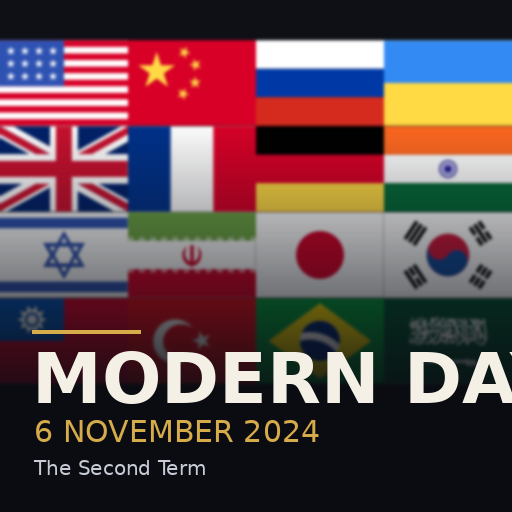

# Modern Day: 2024 — a Hearts of Iron IV mod

The world on **6 November 2024**, the morning Donald Trump's victory was
called. Joe Biden is a lame duck until 20 January. Russia is grinding
forward in the Donbas while Ukraine holds part of Kursk. Israel is fighting
on seven fronts. Germany's coalition collapses that very evening, and in
three weeks the Assad regime will be gone.



## Installing

The mod needs one step on your own PC: it reads **your** copy of HOI4 to
draw the 2024 borders (HOI4's map files can't be redistributed, so they
aren't in this repository).

**Windows**

1. Install Python 3 from <https://www.python.org/downloads/>. Tick **Add
   python.exe to PATH** in the installer.
2. Download this repository (Code → Download ZIP) and unzip it.
3. Double-click `hoi4-modern-day\SETUP.bat`.

**macOS / Linux**

```bash
./hoi4-modern-day/setup.sh
```

Setup finds your Steam install by itself, including other Steam library
folders. If it can't, pass the folder in Steam: right-click Hearts of Iron IV
→ Manage → Browse local files, copy the path, then:

```bash
python tools/setup_mod.py --game "D:\SteamLibrary\steamapps\common\Hearts of Iron IV"
```

Setup builds the map, validates the whole mod and copies it to
`Documents\Paradox Interactive\Hearts of Iron IV\mod`. Then open the launcher,
add **Modern Day: 2024** to a playset, and start the **The Second Term**
bookmark. It takes about a minute and downloads nothing except the two
Python packages it uses (Pillow and numpy).

## What's in it

| | |
|---|---|
| Countries | 177, each with the government, head of government, parties and party popularity in office on 6 Nov 2024 |
| Leaders | 216 country leaders, including successors who take office by event (Trump, Merz, Carney, Lee Jae-myung, Takaichi and more), plus 40 named advisors, among them Trump's cabinet from 20 January |
| Portraits | A stylised portrait for every leader and advisor, set against their national flag |
| Focus trees | 558 focuses: full trees for the **USA** (Biden's lame-duck branch, then the second-term agenda: DOGE, tariffs and Liberation Day, the border, energy, AI, NATO, Ukraine, Gaza, Iran, Greenland, Panama, Golden Dome), **Russia**, **Ukraine**, **China**, **UK**, **Germany**, **France**, **Israel**, **Iran** and **Taiwan**; custom branches for **India, Japan, South Korea, Turkey, Poland, Saudi Arabia, Canada and Brazil**; and a modern generic tree for everyone else (economy, military, West/BRICS/non-aligned diplomacy, politics) |
| Spirits & traits | 256 national spirits (sanctions, war economies, Iron Dome, the Silicon Shield, the debt brake...) and 71 leader and advisor traits |
| Events | The 2024–25 timeline: Germany's coalition collapse, the Hezbollah ceasefire, the HTS offensive and the fall of Assad, South Korean martial law and impeachment, Romania's annulled election, Georgia's protests, the inauguration, the Gaza ceasefire, the Twelve-Day War, Operation Sindoor, and 14 routine changes of government. Ukraine ceasefire talks run through focuses and decisions. |
| Decisions | Economy, defence procurement, diplomacy (including applying to join NATO), the Russo-Ukrainian war, the Middle East crisis, and strategic arsenals |
| Map (built by setup) | 2024 borders for every state, Russia's front line in Ukraine as of November 2024 plus Ukraine's Kursk salient, Crimea, Idlib (HTS), the SDF's north-east Syria, Sudan's RSF, the Houthi north of Yemen, Libya's two governments, Somaliland, Kosovo and Taiwan. Cores and claims for disputed territory. Populations, factories and infrastructure rescaled to 2024. Starting armies at the front, capitals and victory points. Technology by development tier. The NATO alliance and the war in Ukraine. |
| AI | 2024 strategies replace vanilla's 1936 plans |

The four ideology groups are renamed for the setting: **Democracy**,
**Communism**, **Nationalism** and **Authoritarianism**.

## Rebuilding

Everything in `ModernDay2024/` is generated from the data in `tools/data/`.
Edit the data, then rebuild:

```bash
python3 tools/build.py                 # everything, including art (needs cairosvg)
python3 tools/build.py --no-art        # script, localisation and map only
HOI4_DIR="<game folder>" python3 tools/build.py --no-art   # with the map
python3 tools/validate.py              # static checks
```

To test the map builder without the game, there is a synthetic HOI4 install
generator:

```bash
python3 tools/tests/make_synthetic_game.py /tmp/fakehoi4 --miller
HOI4_DIR=/tmp/fakehoi4 python3 tools/build.py --no-art && python3 tools/validate.py
```

Then rebuild without `HOI4_DIR` before committing, so test geography never
ships.

## Testing and limits

- `tools/validate.py` checks the whole mod without the game: balanced braces,
  localisation files (BOM, format, duplicate keys) and every cross-reference:
  spirits, traits, events, focuses, characters, scripted effects, opinion
  modifiers, sprites, textures, portraits, flags, country tags, modifiers,
  state ownership, capitals and army positions. It passes with 0 errors.
- The map builder has been run end-to-end on a synthetic HOI4 install with a
  distorted, HOI4-like projection. It has **not** yet been run on the real
  game files, and the mod has not been loaded in HOI4. If the launcher or the
  game's `error.log` complains about something, open an issue with the log.
- Built for HOI4 1.16. Newer patches show a version warning in the launcher
  but should load.
- Vanilla events, decisions and on_actions are kept for the game's core
  mechanics. A few 1930s vanilla events may still be able to fire for tags the
  mod reuses (GER, ENG, FRA...).
- Starting armies are infantry, motorised and mechanised brigades. There are
  no tanks, planes or ships at start, because those need DLC-specific designs.
  Build them from the factories.
- Portraits are stylised, not likenesses. To use real ones, drop a 156×210
  `.dds` over `gfx/leaders/<TAG>/md_<TAG>_<name>.dds` (advisors: 65×67 in
  `gfx/interface/advisors/md/`).

## Credits

See [CREDITS.md](CREDITS.md).
